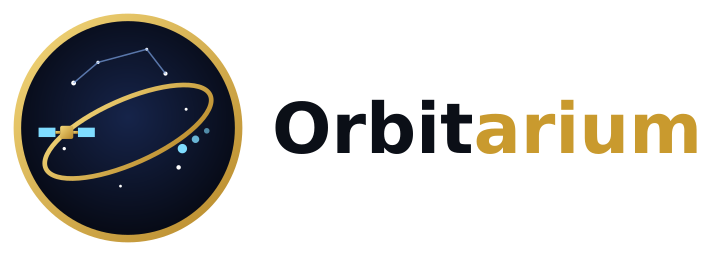

<p align="center">
  
</p>

<p align="center">
  <a href="https://github.com/hacs/integration"></a>
  
  
  
</p>

# Orbitarium

A live planetarium for Home Assistant. Orbitarium shows **every Starlink and thousands of other satellites in real time** above your home, together with stars, constellations, the Sun, the Moon and the planets. It tells you which satellites you can actually see with your own eyes right now, and when the ISS passes over next.

Everything is calculated locally in Home Assistant and in your browser. No API key, no account, no cloud service besides the public orbital data from CelesTrak.

## Features

**Lovelace card** `custom:orbitarium-card` (installed and registered automatically)

- Planetarium view of the whole sky (dome) or towards the horizon, with atmosphere, twilight glow and ground
- Stars down to magnitude 6 with real colours, constellation lines and names, bright star names
- Sun, Moon with its current phase, Mercury to Neptune
- All satellites of the selected groups, moving in real time (SGP4 propagation, 30 fps by default)
- Satellites that are **visible to the naked eye** (sunlit while your sky is dark) glow in their group colour, satellites in Earth's shadow are dimmed
- Tap a satellite for name, NORAD id, elevation, azimuth, range, altitude, speed and status, plus its orbit track
- Group filter with counts, "visible only" mode, labels on/off
- Time travel: pause, fast forward up to 600x, reverse, back to live
- Drag to look around, zoom buttons, pinch / mouse wheel zoom, fullscreen
- Works on phones and wall tablets, pauses itself when it is not on screen

**Sensors**

| Sensor | State | Attributes |
| --- | --- | --- |
| Satellites tracked | number of satellites in the catalogue | count per group, data age, last error |
| Satellites above horizon | satellites above your horizon right now | sun elevation |
| Satellites visible now | sunlit satellites above 10° while the sky is dark | list of the 15 highest ones |
| `<name>` next visible pass | start of the next naked-eye visible pass (timestamp) | max elevation, directions, duration, next 5 visible passes |

Pass sensors are created for every NORAD id you enter (default: ISS `25544` and Tiangong `48274`).

## Installation

### HACS

1. HACS → three dots → **Custom repositories** → add `https://github.com/mb26-dev/ha-orbitarium` as **Integration**
2. Install **Orbitarium** and restart Home Assistant
3. **Settings → Devices & services → Add integration → Orbitarium**

### Manual

Copy `custom_components/orbitarium` into your `config/custom_components` folder and restart Home Assistant.

## Configuration

All settings are done in the UI and can be changed later under **Configure**:

| Option | Default | Description |
| --- | --- | --- |
| Satellite groups | Space stations, Brightest, Starlink | CelesTrak groups to load. Starlink alone has close to 10,000 satellites. |
| Pass predictions for | `25544, 48274` | NORAD ids that get a "next visible pass" sensor |
| Minimum pass elevation | 10° | Lower passes are ignored |

Orbital data is refreshed every 12 hours and cached, so restarts do not download anything again. The star catalogue is downloaded once on first start and then kept locally.

The observer location is your Home Assistant home location.

## The card

```yaml
type: custom:orbitarium-card
```

All options are optional:

```yaml
type: custom:orbitarium-card
title: Orbitarium
view: dome              # dome (whole sky) or horizon
azimuth: 180            # initial viewing direction in degrees
height: 440             # height in px on wide screens, phones use a square-ish layout
fps: 30                 # lower it on weak tablets
star_limit: 6           # faintest star magnitude
show_constellations: true
show_labels: true
show_planets: true
show_ground: true       # false shows objects below the horizon too
visible_only: false     # only satellites that are visible to the naked eye
groups:                 # groups shown when the card opens (default: all loaded groups)
  - stations
  - starlink
latitude: 8.03          # optional override of the home location
longitude: 98.82
```

## Automation example

Get a notification 10 minutes before the ISS is visible:

```yaml
alias: ISS visible pass reminder
triggers:
  - trigger: template
    value_template: >-
      
      {{ t not in ['unknown', 'unavailable'] and
         (as_timestamp(t) - as_timestamp(now())) | int(-1) in range(0, 600) }}
actions:
  - action: notify.notify
    data:
      title: ISS overhead soon
      message: >-
        The ISS will be visible at
        {{ as_timestamp(states('sensor.orbitarium_iss_next_visible_pass')) | timestamp_custom('%H:%M') }},
        from {{ state_attr('sensor.orbitarium_iss_next_visible_pass', 'start_direction') }}
        to {{ state_attr('sensor.orbitarium_iss_next_visible_pass', 'end_direction') }},
        max {{ state_attr('sensor.orbitarium_iss_next_visible_pass', 'max_elevation') }}° high.
mode: single
```

## How "visible" is decided

A satellite counts as visible to the naked eye when it is at least 10° above the horizon, lit by the Sun, less than 2,000 km above the Earth, and the Sun is at least 6° below your horizon. Brightness (magnitude) is not modelled, so faint satellites can be counted as well. Starlink trains shortly after a launch are very bright, older Starlinks are often hard to see.

## Accuracy

Satellite positions use SGP4 with the newest CelesTrak elements, which is accurate to roughly a kilometre for fresh data. Geostationary and navigation satellites use a simplified model without lunar-solar perturbations, which is more than enough for a sky view. Sun, Moon and planets use low precision formulas (well below 1° for this purpose).

## Credits

- Orbital elements: [CelesTrak](https://celestrak.org)
- Stars and constellations: [d3-celestial](https://github.com/ofrohn/d3-celestial) by Olaf Frohn (BSD-3-Clause)
- SGP4: port of [satellite.js](https://github.com/shashwatak/satellite-js) (MIT), based on the work of David Vallado

See [THIRD_PARTY_NOTICES.md](THIRD_PARTY_NOTICES.md) for the licence texts.
